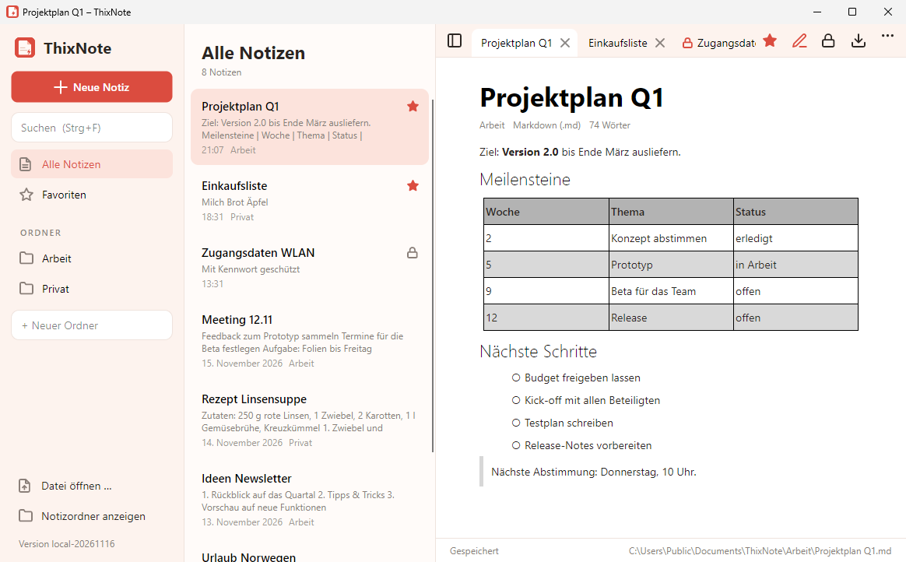
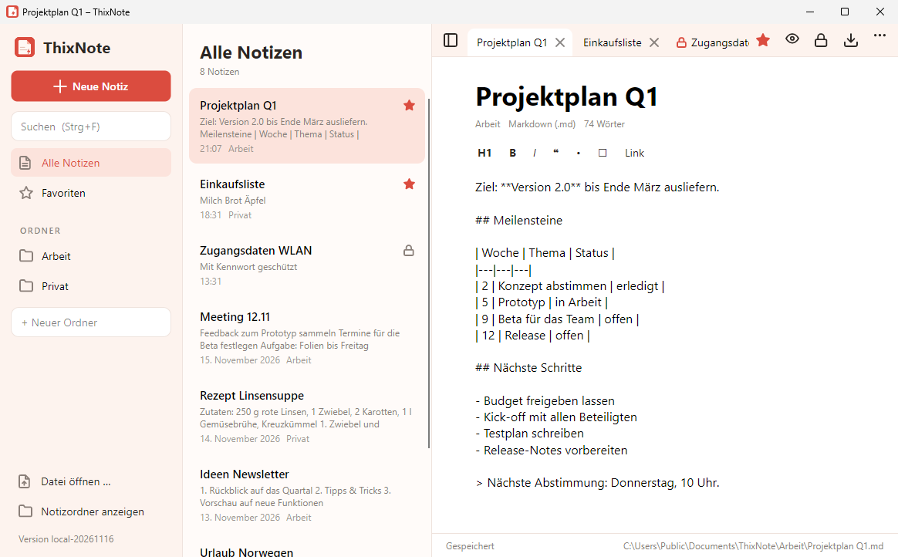
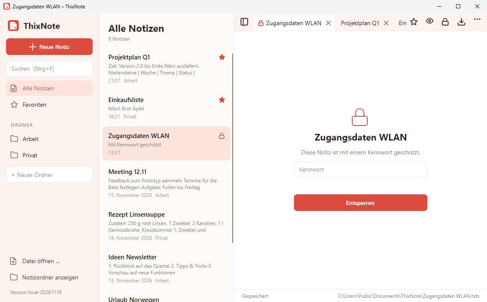
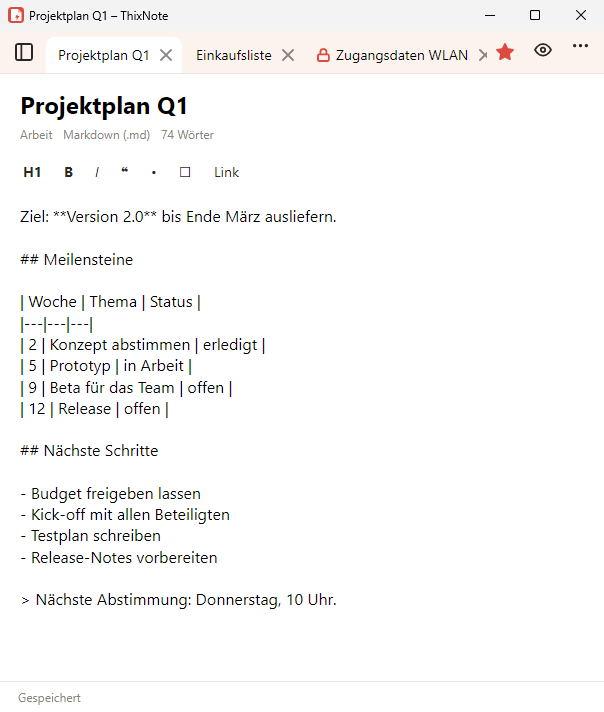
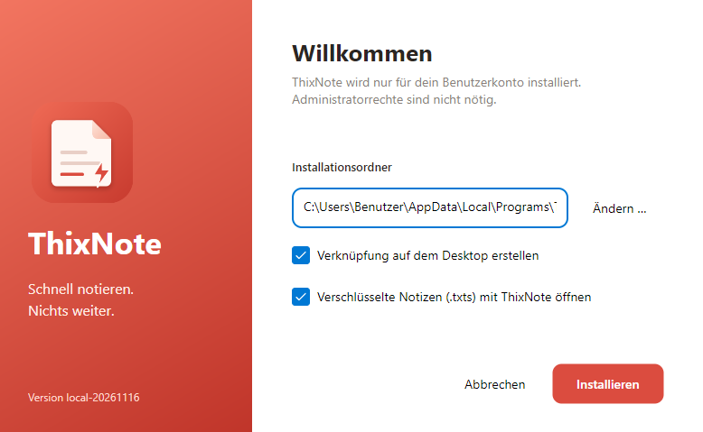

<p align="center"></p>

# ThixNote

Eine bewusst einfache Notiz-App für Windows und macOS (C#, Avalonia UI), optisch angelehnt an Todoist. Breit gezogen ist sie eine kleine Notizbibliothek. Schmal gezogen wird sie zum Editor mit Tabs, ähnlich wie Notepad.



## Screenshots

| Bearbeiten | Kennwortgeschützte Notiz |
|---|---|
|  |  |

| Schmales Fenster | Setup (Windows) |
|---|---|
|  |  |

## Installation

Fertige Builds gibt es unter [Releases](https://github.com/Real-TTX/ThixNote/releases):

- **Windows:** `ThixNote-Setup-<version>-win-x64.exe` installiert pro Benutzer, ohne Adminrechte. Alternativ das Portable-Zip.
- **macOS:** DMG für Apple Silicon (`osx-arm64`) und Intel (`osx-x64`), alternativ das Portable-Zip.

Nightlies aus dem Branch `dev` stehen dort als Pre-Release.

## So funktioniert es

- **Notizen sind normale Dateien** in `Dokumente/ThixNote`. Der Dateiname ist der Titel, Unterordner sind Ordner. Es gibt keine Datenbank und keinen versteckten Index.
  - `.md`: Markdown (Standard für neue Notizen)
  - `.txt`: reiner Text
  - `.txts`: mit Kennwort verschlüsselt (AES-256-GCM, Schlüssel per PBKDF2-SHA256 mit 600 000 Iterationen)
- **Wie Notepad nutzbar:** Doppelklick auf eine `.txts`, `.md` oder `.txt` öffnet sie in ThixNote. Ist ThixNote schon offen, kommt sie als neuer Tab ins laufende Fenster. Drag & Drop auf das Fenster geht auch.
- **Tabs:** mehrere Notizen gleichzeitig. Offene Tabs werden beim nächsten Start wiederhergestellt. Verschlüsselte Tabs sind dann wieder gesperrt.
- **Schmales Fenster** (unter 900 px): Seitenleiste und Notizliste verschwinden, nur Tabs und Editor bleiben. Über ☰ klappt die Bibliothek als Overlay auf.
- **Kennwortschutz:** Beim Öffnen einer `.txts` fragt ThixNote im Tab nach dem Kennwort. Das Kennwort selbst wird nie gespeichert, nur der abgeleitete Schlüssel bleibt im Arbeitsspeicher, solange die Notiz entsperrt ist.
- Automatisches Speichern, Favoriten, Suche, Markdown-Vorschau, Export als Markdown, HTML oder Text. Löschen verschiebt in den Papierkorb.

### Tastenkürzel (macOS: ⌘ statt Strg)

| Kürzel | Aktion |
|---|---|
| Strg+N / Strg+T | Neue Notiz (neuer Tab) |
| Strg+O | Datei öffnen |
| Strg+S | Speichern (passiert auch automatisch) |
| Strg+W | Tab schließen |
| Strg+Tab / Strg+Umschalt+Tab | Nächster / vorheriger Tab |
| Strg+F / Strg+K | Suchen |
| Strg+E | Vorschau / Bearbeiten |
| Strg+L | Verschlüsselte Notiz sperren |
| Strg+D | Favorit |
| Strg+B / Strg+I | Fett / Kursiv |

## Umstieg von QuickNote

ThixNote hieß früher QuickNote. Das alte Repository wird nicht weitergeführt.

- Beim ersten Start übernimmt ThixNote die Einstellungen aus `AppData/QuickNote` und verschiebt `Dokumente/QuickNote` nach `Dokumente/ThixNote`. Favoriten und offene Tabs zeigen danach auf die neuen Pfade. Ein selbst gewählter Notizordner bleibt, wo er ist.
- Das Setup entfernt eine alte QuickNote-Installation (Programmdateien, Verknüpfungen, Registry-Einträge). Die Notizen bleiben dabei unberührt.
- Verschlüsselte `.txts`-Dateien behalten ihre Formatkennung `QNSEC1` und lassen sich weiter öffnen.

## Aufbau

| Projekt | Inhalt |
|---|---|
| `src/ThixNote.Core` | Modelle (reine Daten) und Business-Layer, nur statische Klassen: `NoteLibrary`, `NoteContent`, `NoteEncryption`, `EncryptionSession`, `AccessGuard`, `NoteExporter`, `SettingsStore`, `QuickNoteMigration` |
| `src/ThixNote.App` | Avalonia-UI (MVVM mit CommunityToolkit.Mvvm). UI und Modelle greifen nie direkt auf Dateien zu |
| `src/ThixNote.Setup` | Eigener, gestalteter Windows-Installer (Avalonia). Bettet die App ein, installiert pro Benutzer, registriert `.txts` |
| `tests/ThixNote.Core.Tests` | Unit-Tests für Business-Layer und Berechtigungen |
| `tools/IconGen` | Erzeugt PNG, ICO und ICNS aus den Logo-SVGs (je Größe die passende Detailstufe) |
| `assets/logo` | App-Logo in drei Detailstufen, Wordmark und Datei-Icon für `.txts` |

Berechtigungen prüft `AccessGuard` immer im Business-Layer. Beispiele: Verschlüsselte Notizen lassen sich nur entsperrt lesen, schreiben oder exportieren. ThixNote fasst nur `.md`, `.txt` und `.txts` an. Schreibgeschützte Dateien bleiben unangetastet.

## Versionierung

| Kanal | Branch | Format | Beispiel |
|---|---|---|---|
| Release | `main` | `<major>.<minor>.<build>-<builddate>` | `1.0.42-20261114` |
| Nightly | `dev` | `nightly-<build>-<builddate>` | `nightly-42-20261114` |
| Local | alles andere | `local-<builddate>` | `local-20261114` |

`major.minor` steht in der Datei `VERSION`, die Build-Nummer ist die Nummer des GitHub-Actions-Laufs. Die Logik dazu liegt in `Directory.Build.props`.

## Bauen

```bash
dotnet test tests/ThixNote.Core.Tests
dotnet run --project src/ThixNote.App
```

Windows (Setup und Portable-Zip landen in `artifacts/`):

```powershell
./build/Build-Windows.ps1                                    # local
./build/Build-Windows.ps1 -Channel nightly -BuildNumber 42   # wie CI auf dev
```

macOS (`.app`, Portable-Zip, DMG):

```bash
build/build-macos.sh local 0 osx-arm64
```

Weitere Werkzeuge:

- Icons neu erzeugen: `dotnet run --project tools/IconGen -- .`
- Isoliertes Testprofil, ohne die echten Einstellungen und Notizen anzufassen: Umgebungsvariable `THIXNOTE_PROFILE=<ordner>` setzen.
- Screenshot eines laufenden Fensters für UI-Checks und für die Bilder in `docs/images`: `build/Capture-Window.ps1` (schneidet auf den sichtbaren Fensterrahmen zu). Für die README-Bilder mit `THIXNOTE_PROFILE` und Beispielnotizen arbeiten, damit keine echten Notizen oder Pfade zu sehen sind.

## CI/CD

`.github/workflows/build.yml` läuft bei jedem Push und Pull Request:

1. Tests
2. Windows: Setup und Portable
3. macOS: arm64 und x64, jeweils DMG und Portable

Bei Pushes auf `main` entsteht ein GitHub-Release, bei Pushes auf `dev` ein Pre-Release (Nightly).

## Hinweise

- macOS: Das DMG ist nur ad-hoc signiert (kein Apple-Developer-Konto). Beim ersten Start Rechtsklick auf die App und „Öffnen“ wählen.
- Windows: Setup und Exe sind nicht signiert. SmartScreen kann beim ersten Start nachfragen.
- Notizen aus der allerersten Version (damals noch QuickNote, GUID-Dateinamen) werden beim Start automatisch nach ihrem Titel umbenannt. Verschlüsselte alte Notizen werden beim ersten Entsperren umgestellt.
