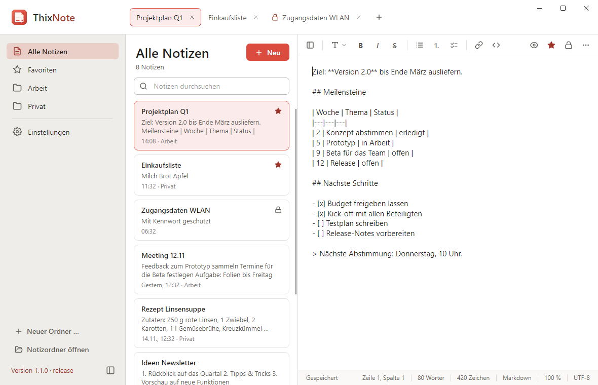
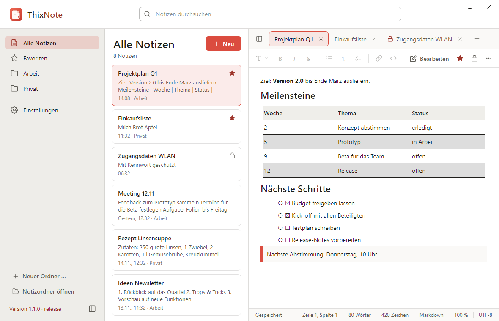
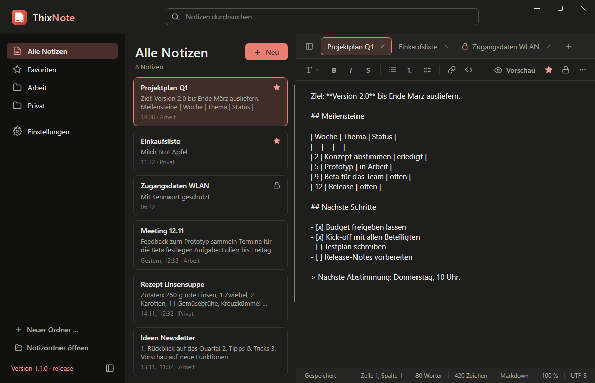
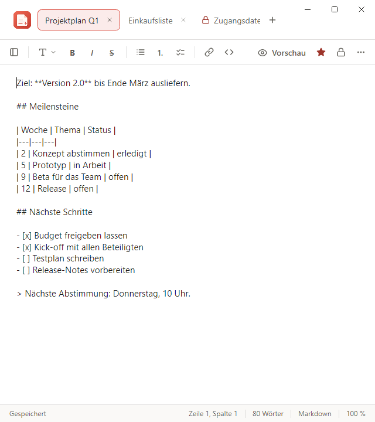
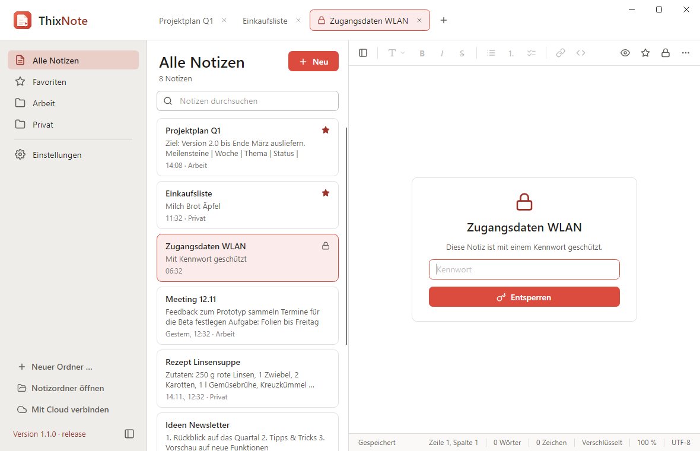
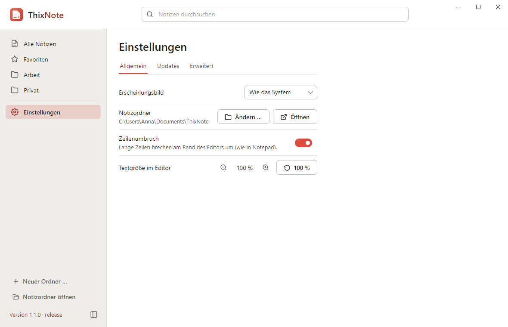
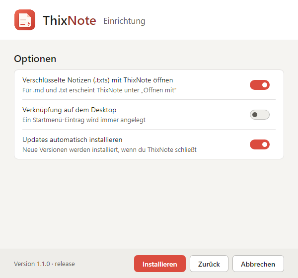
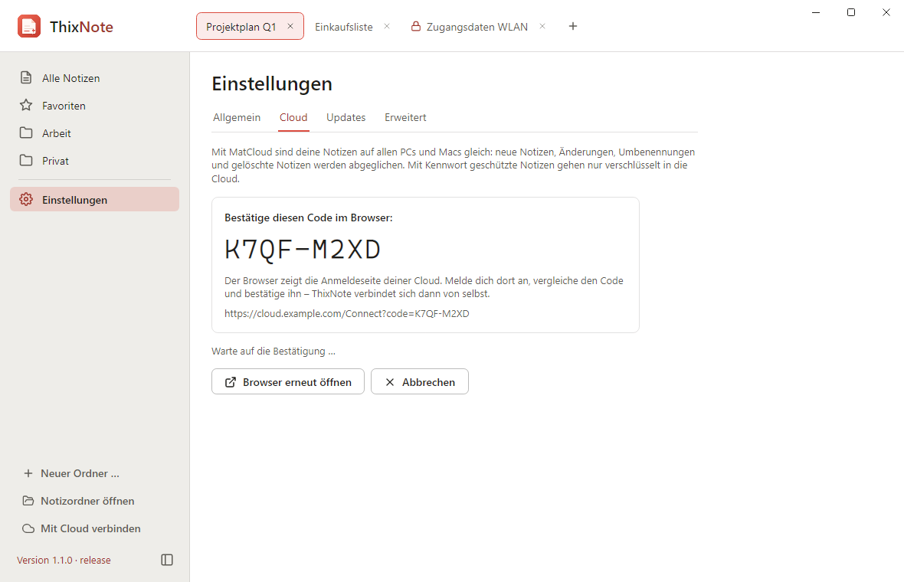
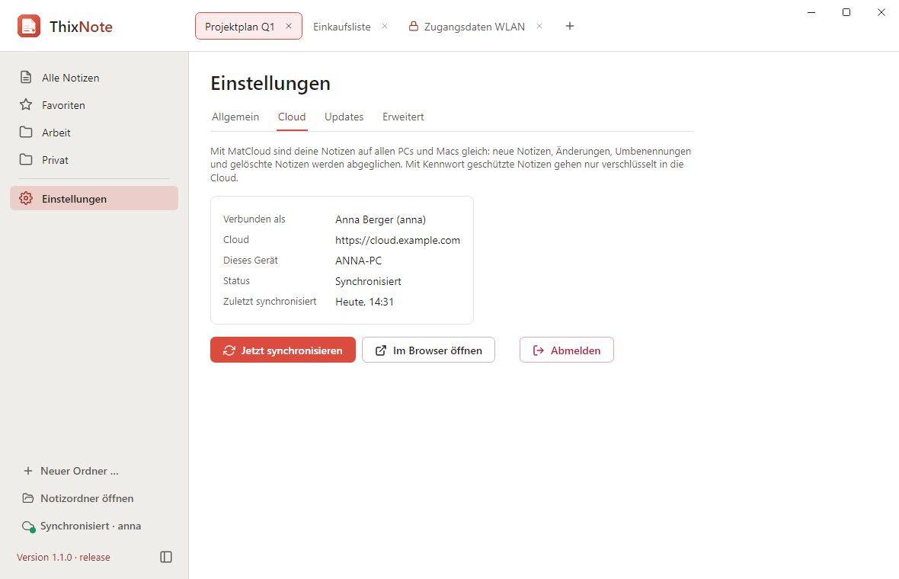

<p align="center"></p>

# ThixNote

Eine bewusst einfache Notiz-App für Windows und macOS (C#, Avalonia mit MatDesktop). Jede Notiz ist eine normale Datei. Aufgebaut wie Notepad: die Tabs in der Titelleiste, darunter die Formatierungsleiste, der Text und die Statusleiste. Daneben eine kleine Notizbibliothek, die in der Kompaktansicht ganz verschwindet. Aufbau, Setup und Updates folgen ThixClip und den Desktop-Regeln von MatDesign (DESK, SETUP).



## Screenshots

| Markdown-Vorschau | Dunkel |
|---|---|
|  |  |

| Kompaktansicht wie Notepad | Kennwortgeschützte Notiz |
|---|---|
|  |  |

| Einstellungen | Setup (Windows) |
|---|---|
|  |  |

| Mit MatCloud verbinden | Verbunden |
|---|---|
|  |  |

Alle Bilder in [`docs/images`](docs/images) gibt es hell und dunkel. Sie entstehen mit `ThixNote --snapshot` aus Beispielnotizen.

## Installation

Fertige Builds liegen unter [Releases](https://github.com/Real-TTX/ThixNote/releases):

- **Windows:** `ThixNoteSetup.exe` installiert ThixNote für dein Benutzerkonto, ohne Administratorrechte, nach `%LocalAppData%\Programs\ThixNote`. Die Exe ist zugleich ihr eigenes Setup: Starten heißt installieren oder aktualisieren, „Installierte Apps“ ruft die Deinstallation auf.
- **macOS:** `ThixNote-macOS-arm64.dmg` (Apple Silicon) oder `ThixNote-macOS-x64.dmg` (Intel) öffnen und ThixNote in „Programme“ ziehen.
- Oder über **ThixLauncher**, der die Thix-Apps installiert und aktuell hält.

Ohne Fenster (für Skripte, Intune und Ähnliches):

| Befehl | Wirkung |
|---|---|
| `ThixNoteSetup.exe --quiet` | installiert mit den Standardoptionen |
| `ThixNoteSetup.exe --update` | installiert oder aktualisiert still, mit `--restart` startet ThixNote danach |
| `ThixNote.exe --uninstall [--quiet]` | deinstalliert; die Notizen bleiben immer erhalten |

### Updates

Jeder Kanal hat ein mitlaufendes Release: `release-channel` (Branch `main`) und `nightly-channel` (Branch `dev`). Darin liegt `thixnote-update.json` mit Version, Build-Nummer und SHA-256 jedes Pakets. ThixNote prüft kurz nach dem Start und danach alle 6 Stunden, lädt eine neue Version im Hintergrund und prüft die Prüfsumme.

**Installiert wird beim Schließen von ThixNote**, nie mitten beim Schreiben. Wer nicht warten will, nimmt „Jetzt installieren und neu starten“ unter Einstellungen › Updates; ThixNote öffnet danach wieder mit allen Tabs. Lokale Builds aktualisieren sich nie selbst.

Administratoren können per Richtlinie eingreifen: Windows `HKLM\SOFTWARE\Policies\ThixNote` (DWORD 1), macOS Konfigurationsprofil `info.schmoldt.thixnote`:

- `LockConfiguration` sperrt die Einstellungen.
- `DisableCloud` schaltet die Synchronisierung mit MatCloud ab: keine Notiz verlässt den Computer.
- `DisableUpdates` schaltet die Updates ab.

## So funktioniert es

- **Notizen sind normale Dateien** in `Dokumente/ThixNote` (in den Einstellungen änderbar). Der Dateiname ist der Titel, Unterordner sind Ordner. Es gibt keine Datenbank.
  - `.md`: Markdown (Standard für neue Notizen)
  - `.txt`: reiner Text
  - `.txts`: mit Kennwort verschlüsselt (AES-256-GCM, Schlüssel per PBKDF2-SHA256 mit 600 000 Iterationen)
- **Der Titel steht im Tab, nicht im Text.** Umbenennen geht mit F2 oder einem Doppelklick auf den Tab. Eine neue Notiz heißt nach ihrer ersten Zeile, bis du sie selbst umbenennst.
- **Aufgebaut wie Notepad:** Die Tabs stehen in der Titelleiste, direkt darunter die Formatierungsleiste, dann nur der Text, unten die Statusleiste mit Zeile, Spalte, Wörtern, Zeichen, Typ und Zoom. Die Suche steht über der Notizliste.
  - Die Formatierungsleiste bietet Überschrift, Fett, Kursiv, Durchgestrichen, Listen, Aufgaben, Link und Code. Bei `.txt` ist sie ausgegraut. Wird der Editor schmal, rückt sie zusammen.
- **Kompaktansicht** (Strg+Umschalt+K, „Mehr“-Menü oder Einstellungen; unter 900 px Fensterbreite immer): ThixNote ist dann Notepad, nur Logo und Tabs in der Titelleiste, Formatierungsleiste, Text und Statusleiste. Das Menü verschwindet, die Notizliste öffnet sich über dem Editor (Strg+F oder das Seitenleisten-Symbol). ThixNote merkt sich die Ansicht.
- **Wie Notepad nutzbar:** Doppelklick auf `.txts`, `.md` oder `.txt` öffnet die Datei in ThixNote. Läuft ThixNote schon, kommt sie als neuer Tab ins offene Fenster. Drag & Drop geht auch.
- **Tabs** werden beim nächsten Start wiederhergestellt. Verschlüsselte Tabs sind dann wieder gesperrt.
- **Kennwortschutz:** Eine `.txts` fragt im Tab nach dem Kennwort. Das Kennwort selbst wird nie gespeichert, nur der abgeleitete Schlüssel bleibt im Arbeitsspeicher, solange die Notiz entsperrt ist.
- Außerdem: automatisches Speichern, Favoriten, Ordner, Suche über alle Notizen, Markdown-Vorschau, Export als Markdown, HTML oder Text, Erscheinungsbild hell, dunkel oder wie das System. Löschen verschiebt in den Papierkorb.

### Tastenkürzel (macOS: ⌘ statt Strg)

| Kürzel | Aktion |
|---|---|
| Strg+N / Strg+T | Neue Notiz (neuer Tab) |
| Strg+O | Datei öffnen |
| Strg+S | Speichern (passiert auch automatisch) |
| Strg+W | Tab schließen |
| Strg+Tab / Strg+Umschalt+Tab | Nächster / vorheriger Tab |
| F2 | Notiz umbenennen |
| Strg+F / Strg+K | Suchen |
| Strg+E | Vorschau / Bearbeiten |
| Strg+B / Strg+I | Fett / Kursiv |
| Strg+D | Favorit |
| Strg+L | Verschlüsselte Notiz sperren |
| Strg+Plus / Strg+Minus / Strg+0 | Text größer / kleiner / Originalgröße |
| Strg+1 / Strg+2 | Alle Notizen / Favoriten |
| Strg+Umschalt+L | Notizliste ein- und ausblenden |
| Strg+Umschalt+B | Menü einklappen |
| Strg+Umschalt+K | Kompaktansicht ein und aus |
| Strg+, | Einstellungen |

## Sync mit MatCloud

Mit MatCloud, der Cloud der Thix-Apps (selbst betrieben, Docker), sind deine Notizen auf allen PCs und Macs gleich – und im Browser unter `/Note` deiner MatCloud: lesen (Markdown als Seite), suchen, schreiben, umbenennen, verschieben, löschen; geschützte Notizen werden nur im Browser mit ihrem Kennwort geöffnet. ThixNote legt seine Notizen in der allgemeinen Synchronisierung von MatCloud ab (App `note`); die Seiten im Browser (Modul `MatCloud.Apps.Note`) lesen und schreiben dieselben Einträge. „Im Browser öffnen“ in Einstellungen › Cloud führt dorthin.

**Verbinden:** Einstellungen › Cloud (Strg+, und dann der Tab „Cloud“, oder unten im Menü „Mit Cloud verbinden“).

1. Die Adresse deiner MatCloud eintragen (z. B. `https://cloud.example.com`) und den Namen dieses Geräts prüfen.
2. **Im Browser anmelden:** ThixNote zeigt einen Code groß an und öffnet die Anmeldeseite der Cloud. Dort anmelden (mit Passwort oder über MatIdentity), den Code vergleichen und bestätigen. ThixNote verbindet sich dann von selbst; „Abbrechen“ beendet das Warten.
3. Oder **mit Benutzername und Passwort** eines lokalen Kontos der Cloud. Das Passwort wird nur für die Anmeldung gebraucht und nie gespeichert.

Gespeichert wird nur ein Geräte-Token, geschützt für dein Benutzerkonto (Windows: DPAPI, macOS: Schlüsselbund). In der Cloud unter „Geräte“ lässt sich der Computer jederzeit entfernen; ThixNote meldet sich dann ab. „Abmelden“ in den Einstellungen tut dasselbe von hier aus, die Notizen auf dem Computer bleiben.

**Was abgeglichen wird:**

- Jede Notiz (`.md`, `.txt`, `.txts`) ist ein Eintrag mit einem festen Schlüssel: Inhalt, Umbenennen und Verschieben in einen anderen Ordner kommen auf den anderen Geräten an, auch wenn du die Datei im Explorer oder Finder verschiebst. Ordner kommen mit, auch leere.
- **Kennwortgeschützte Notizen (`.txts`) gehen nur verschlüsselt** in die Cloud, Byte für Byte wie die Datei. Die Cloud sieht ihren Text nie, entsperrt wird mit demselben Kennwort auf jedem Gerät.
- Gelöschte Notizen landen auf den anderen Geräten im Papierkorb, nicht im Nichts.
- **Konflikt:** Wurde eine Notiz hier und auf einem anderen Gerät geändert, bleiben beide. Die Fassung aus der Cloud behält den Namen, die von hier liegt daneben als „Titel (Konflikt Gerätename).md“ und wird als eigene Notiz abgeglichen.
- Eine Notiz, die in einem Tab ungespeicherte Änderungen hat, wird nie angefasst. Ihre Änderung aus der Cloud wartet, bis du speicherst. Offene Tabs folgen einer Umbenennung von anderswo und zeigen den neuen Text.
- Beim ersten Verbinden gehen alle Notizen dieses Computers hoch und alle aus der Cloud kommen herunter. Notizen, die es auf beiden Seiten schon gleich gab, werden zusammengeführt statt verdoppelt.
- ThixNote gleicht im Hintergrund ab: sofort nach dem Speichern, und Änderungen anderer Geräte kommen innerhalb von Sekunden (Long Poll). Ohne Netz wartet es und versucht es wieder. Der Stand steht unten im Menü und unter Einstellungen › Cloud („Jetzt synchronisieren“).
- Wählst du einen anderen Notizordner, wird dieser mit der Cloud abgeglichen wie beim ersten Verbinden.

## Umstieg von QuickNote

ThixNote hieß früher QuickNote. Das alte Repository wird nicht weitergeführt.

- Beim ersten Start übernimmt ThixNote die Einstellungen aus `AppData/QuickNote` und verschiebt `Dokumente/QuickNote` nach `Dokumente/ThixNote`. Favoriten und offene Tabs zeigen danach auf die neuen Pfade. Ein selbst gewählter Notizordner bleibt, wo er ist.
- Das Setup entfernt eine alte QuickNote-Installation (Programmdateien, Verknüpfungen, Registry-Einträge). Die Notizen bleiben dabei unberührt.
- Verschlüsselte `.txts`-Dateien behalten ihre Formatkennung `QNSEC1` und lassen sich weiter öffnen.
- QuickNote hatte noch keine Updates: Die erste ThixNote-Version muss einmal von Hand installiert werden.

## Aufbau

| Projekt | Inhalt |
|---|---|
| `src/ThixNote.Core` | Modelle, Business-Layer (statische Klassen: `NoteLibrary`, `NoteContent`, `NoteEncryption`, `AccessGuard`, `NoteExporter`, `SettingsService`, `AccessPolicy`, `SyncService`, `NoteSync`, `InstallService`, `UpdateService`, `QuickNoteMigration` …), Infrastruktur (`AppPaths`, `AppInfo`, `SettingsStore`, `SyncIndex`, `TokenStore`, `Log`, `ProblemReports`) |
| `src/ThixNote.Core/MatCloud` | Kopie des Vertrags von MatCloud (`MatCloud.Contract`: Routen, DTOs, `MatCloudClient`), wird hier nie bearbeitet |
| `src/ThixNote` | Avalonia-App mit MatDesktop: Hauptfenster, Seiten (Notizen, Einstellungen, Über), Dialoge, Setup, Selbsttest, Snapshots |
| `src/ThixNote/MatDesktop` | Kopie des Desktop-Toolkits aus MatDesign, wird hier nie bearbeitet |
| `tests/ThixNote.Tests` | Business-Layer, Installation an Testorten, Update-Regeln, Oberfläche headless |
| `tools/IconGen` | Erzeugt PNG, ICO und ICNS aus den Logo-SVGs |
| `scripts/` | `package-macos.sh` (App-Bundle, Update-Zip, DMG), `Capture-Window.ps1` (Screenshot eines echten Fensters) |

## Bauen

```bash
dotnet build ThixNote.slnx
dotnet test tests/ThixNote.Tests
dotnet run --project src/ThixNote
```

- Eigene Instanz mit eigenen Einstellungen und Notizen, ohne die echten anzufassen: Umgebungsvariable `THIXNOTE_DATA_DIR=<ordner>` setzen (Notizen liegen dann in `<ordner>/Notizen`).
- Windows-Build wie in der CI: `dotnet publish src/ThixNote -c Release -r win-x64 -o publish`. Ergebnis ist eine getrimmte Single-File-Exe von etwa 35 MB. Mit `publish\ThixNote.exe --self-test bericht.txt` prüft sie sich selbst.
- Bilder für README und MatDesign: `dotnet run --project src/ThixNote -- --snapshot docs/images`.
- Icons neu erzeugen: `dotnet run --project tools/IconGen -- .`
- Neuer Vertrag von MatCloud: `node ../MatCloud/tools/contract-copy.js src/ThixNote.Core` (ein Test prüft die Kopie gegen `matcloud.version`).

## Versionierung

| Kanal | Branch | Format | Beispiel |
|---|---|---|---|
| Release | `main` | `<major>.<minor>.<build>-<builddate>` | `1.1.42-20261116` |
| Nightly | `dev` | `nightly-<build>-<builddate>` | `nightly-42-20261116` |
| Local | alles andere | `local-<builddate>` | `local-20261116` |

`major.minor` steht in `Directory.Build.props`, die Build-Nummer ist die Laufnummer der GitHub-Action `desktop`. Der Update-Check vergleicht sie.

## Hinweise

- macOS: Das DMG ist nur ad-hoc signiert (kein Apple-Developer-Konto). Beim ersten Start Rechtsklick auf die App und „Öffnen“ wählen.
- Windows: Setup und Exe sind nicht signiert. SmartScreen kann beim ersten Start nachfragen.
- Abstürze und Hänger landen als Bericht im Protokollordner und werden beim nächsten Start angezeigt.
